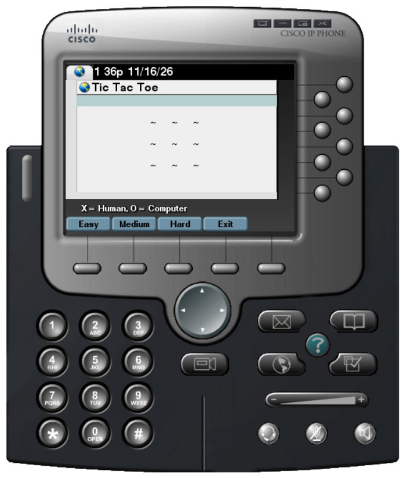

# Tic-Tac-Toe

  

Tic-Tac-Toe is a classic, fast-paced paper-and-pencil strategy game for two players. Because the board has only nine spaces and a limited number of possible combinations, it is known as a "solved" game. If both players use optimal strategy, every match ends in a tie, but learning a few simple patterns guarantees you will either win against casual opponents or force a draw.

In this version you can choose the skill level of your opponent. Picking Easy will almost guarantee a win for every game, as the opponent doesn't incorporate any strategy. Selecting Medium or Hard increases the difficulty, where the Hard selection will always result with a loss or tie when the Opponent takes the first move. Good luck!

# Rules of the Game

* The game is played on a three-by-three grid, creating nine open spaces.

* One player takes the symbol "X" and the other takes "O". By tradition, the player using X makes the first move.

* Players alternate placing their mark in any empty square on the grid. Once a mark is placed, it cannot be moved or removed.

* The first player to get three of their marks in an unbroken horizontal, vertical, or diagonal line wins the game. If all nine squares fill up without either player making three in a row, the game ends in a tie, often called a "cat's game".

# Some Tips to Win or Tie Every Time

* Open in a corner when going first. Starting in a corner gives your opponent the fewest safe responses. If they place their first O anywhere except the center square, you can force a win by claiming the remaining corners and creating two winning lines at once.

*Control the center when going second. If your opponent starts in a corner or on an edge, immediately take the middle square. If they start in the center, claim any corner instead.

*Create and block forks. A "fork" occurs when a single move gives you two different ways to get three in a row on your next turn, making it impossible for your opponent to block both. Always look for chances to set up a fork, and watch the board so you can block your opponent from building one.

* Prioritize immediate threats. On every turn, follow a strict checklist. First, take a winning three-in-a-row move if one is open. Second, block your opponent if they have two in a row. Third, build or block a fork before taking empty corners or edges.

* Avoid edge squares early. The four middle squares along the outer borders offer the fewest ways to make three in a row, so save them for defensive blocks or final moves.
